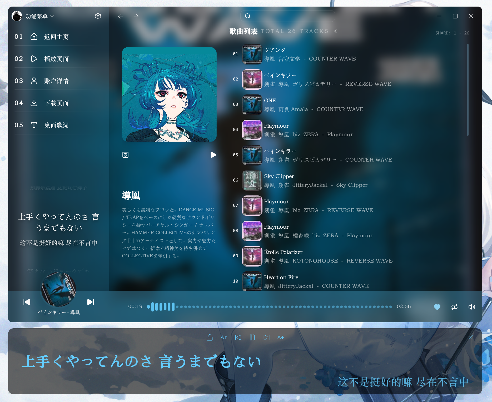
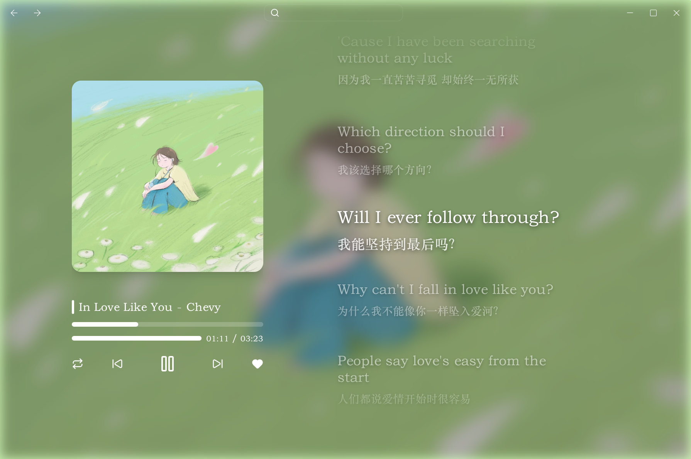
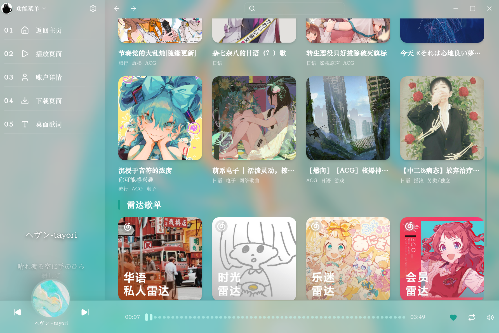
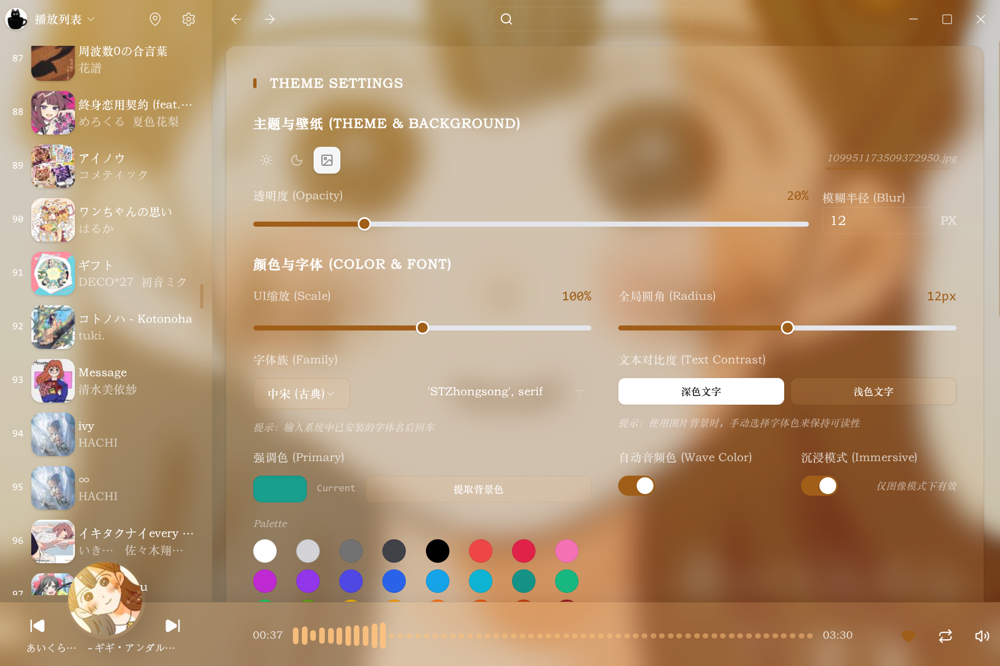

# Vireo

## 设计理念

vireo是一个由[virid](https://github.com/Ailrid/virid)驱动的第三方音乐客户端。其不仅用于实现一个普通的音乐客户端，也是对于virid在真正的应用开发框架中的实战验证。

其核心设计理念如下：

- 尽可能少的前端依赖：vireo尽可能少的使用任何工具依赖，所有的状态管理、UI、服务器接口全部使用virid开发。未使用任何状态管理工具、组件库，所有的Vue组件均尽可能少的具有任何逻辑。
- 尽可能少的后端依赖：vireo使用[@virid/express](https://github.com/Ailrid/virid/tree/main/packages/express)重写了整个NeteaseAPI中有用的一部分功能，彻底摆脱了庞大又难以使用的第三方API接口，并添加了缓存、持久化、日志功能。
- 尽可能多的自定义功能：vireo支持高度美观的自定义功能、背景、主题颜色、字体、缩放、圆角尺寸等等等等。
- Rust编写的wasm音频处理系统(低音增强、音质净化、立体声)：vireo使用Rust编写了一套简单易用的wasm音频增强系统，不需要任何外部依赖即可增强音乐音效。

## 初步效果展示

